# Phase 2: walkthrough on a 10.5" tablet

The debug build of `main` (`ab64c3b9`) on the `ce_tablet_tmp` AVD (1280×800 dp), landscape and portrait, demo server. Findings are numbered *T1*…; later documents refer to them. Screenshots are in [screenshots/](screenshots/), scaled to 1024 px.

**Verdict in one line:** the shell (navigation rail, grids, setup, settings) is already adaptive and looks fine; every page *about an item* is a phone layout stretched to 1280 dp, and the player ignores the tablet entirely.

## What works

- **Home**: navigation rail on the left in both orientations, carousel with 3 pages (landscape) or 2 (portrait), rows and cards scale. 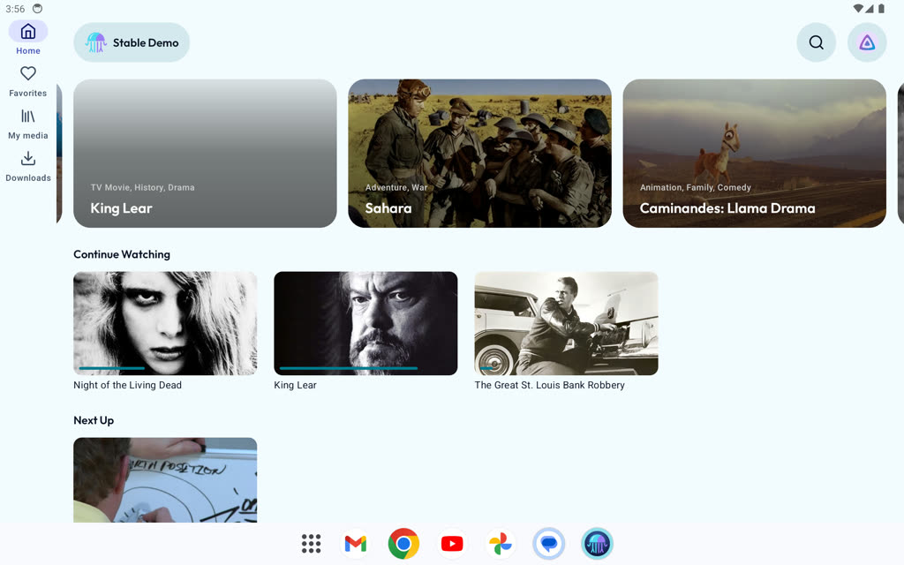 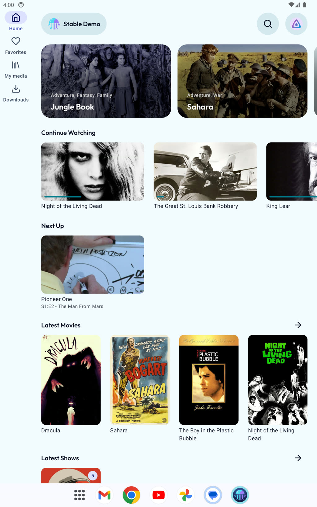
- **Library grid**: 6 poster columns in landscape, 4 in portrait. Search results use the same grid.
- **Settings, About, setup**: centred columns of 640 / 480 dp. 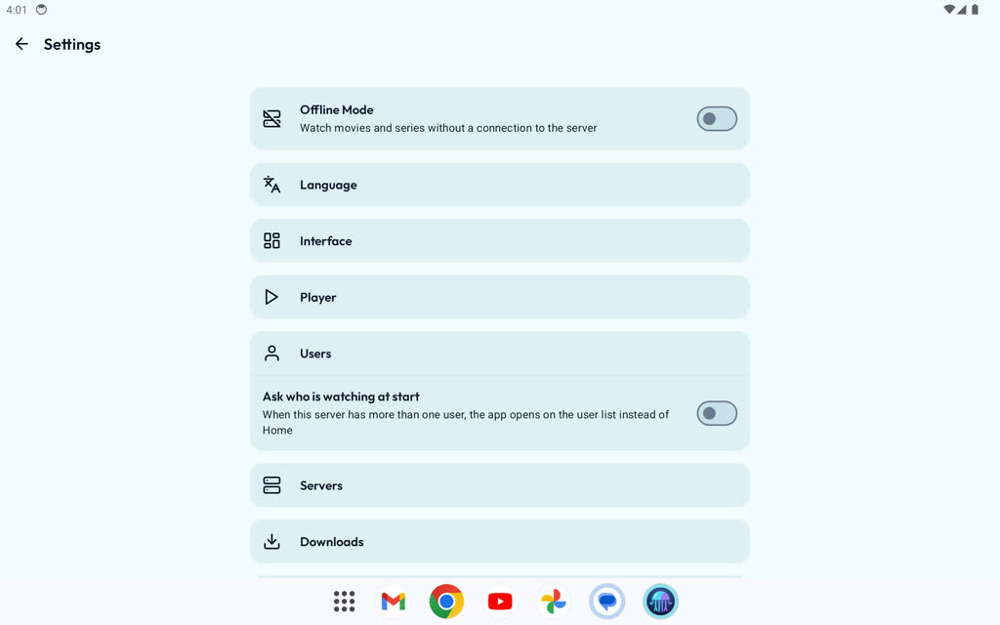 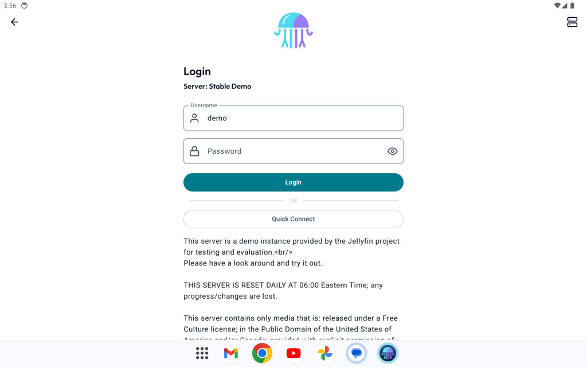
- **Person**: already a two-column layout at 600 dp+. 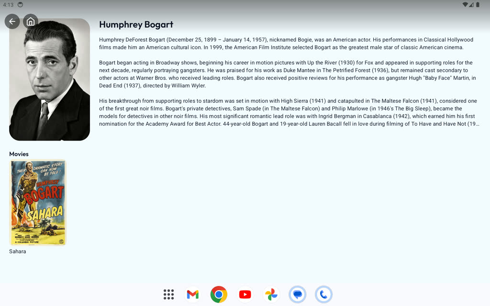
- **Split-screen at 600 dp**: the app keeps the rail, the carousel drops to 1 page, nothing overflows. 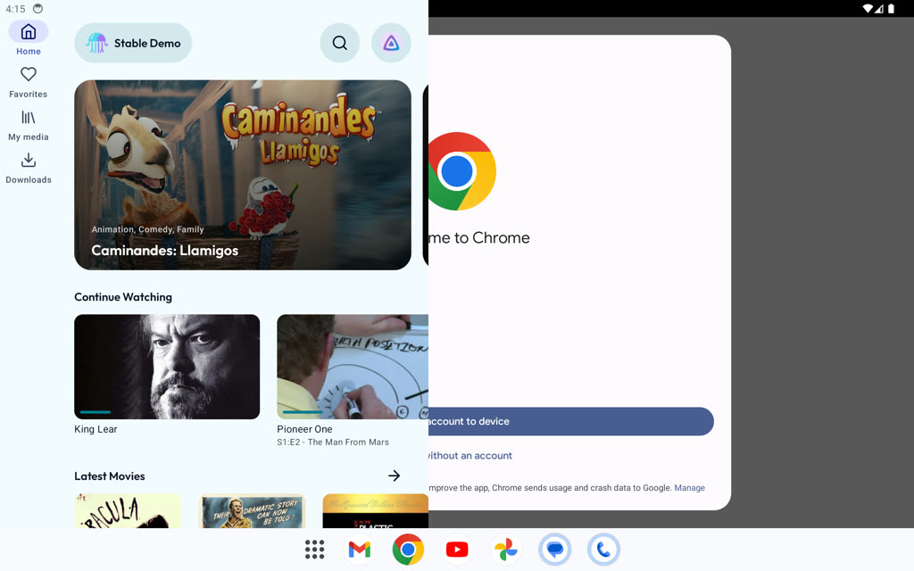
- **Player**: plays, controls are reachable, the seek bar is usable. 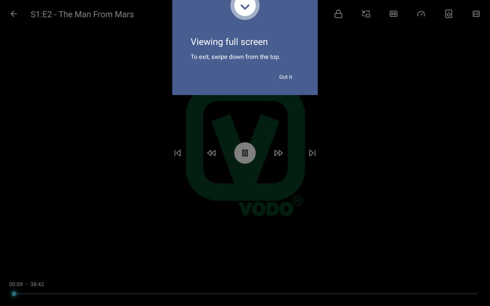

## Findings

| # | Where | Finding | Severity |
|---|---|---|---|
| T1 | Movie, Show, Season, Episode | **Backdrop is a thin, zoomed-in strip.** `ItemHeader` was a fixed 288 dp tall with `ContentScale.Crop`; at 1280 dp wide a 16:9 backdrop is cropped to 4.4:1. Sahara shows helmets, the episode shows a piece of whiteboard. 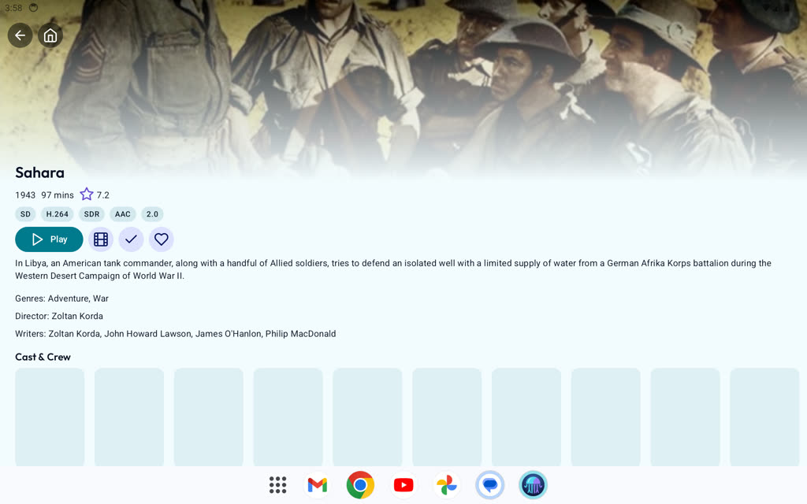 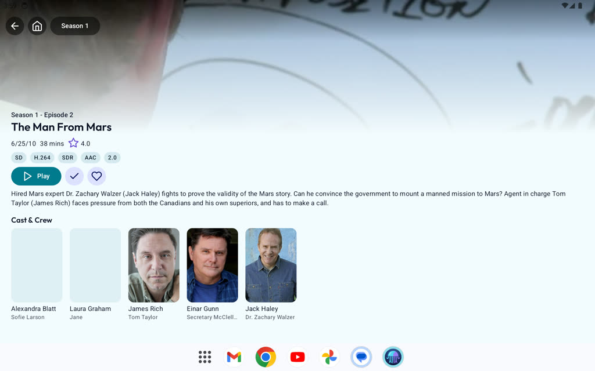 | Must. **Fixed** on this branch, see below. |
| T2 | Movie, Show, Episode | **Text runs the full 1280 dp.** Overview lines of 130+ characters; the metadata, chips and buttons hug the left edge with 60 % of the window empty. | Must. **Fixed** (720 dp cap). |
| T3 | Season | **Episode rows span the window**: 105 dp thumbnail, 1100 dp of text, download button at the far right. 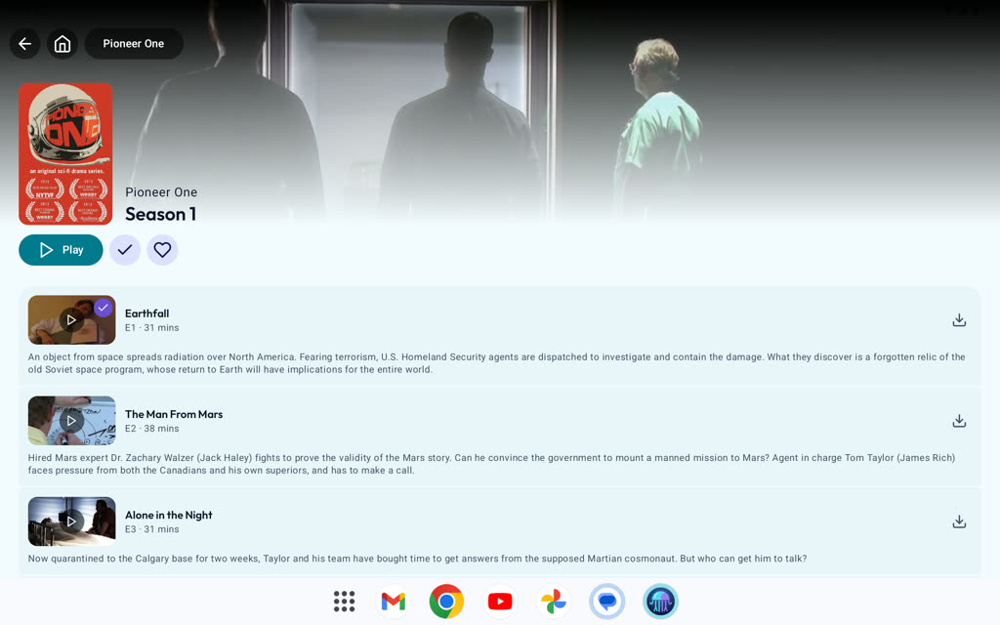 | Must. **Fixed** (720 dp cap). |
| T4 | Movie, Show, Episode | **Below the fold is empty.** After the fix the detail page still uses only the top-left: in landscape the lower 40 % of the window holds nothing but the cast row; in portrait it is half empty. The page needs a two-column layout, not a cap. | Must |
| T5 | Show | **Next Up card is 420 dp wide** on its own line; seasons row and cast row are full width under a 720 dp text column. Mixed widths look accidental. 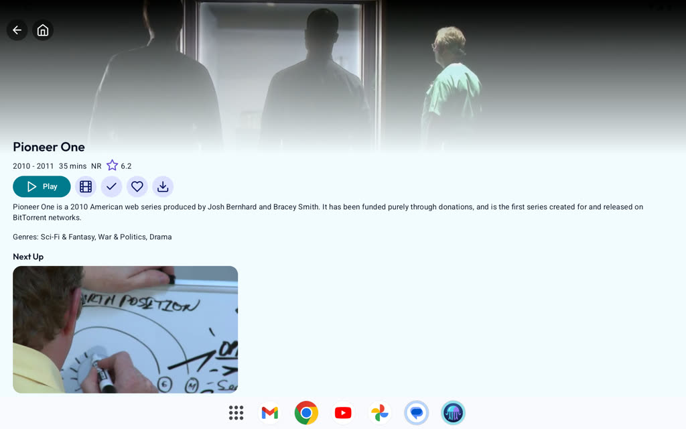 | Should |
| T6 | Player | **Volume and brightness zones are each half the screen** (`viewCenterX`). On a 1280 dp window a swipe 500 dp from the edge still changes volume; the tap-to-show-controls region is effectively the whole screen but any vertical movement becomes a gesture. Same as upstream #1144. | Must |
| T7 | Player | **Forced landscape.** `sensorLandscape` on a tablet means a portrait tablet (or a folded/book-posture foldable) rotates the whole UI for the player, then back. Tier 3 of the adaptive guidelines says apps should "let people use their preferred orientation". | Should |
| T8 | Player | **Controls are phone-sized at 3× the width**: transport buttons clustered in the centre, 272 dp trickplay preview, 64 dp gesture panels, titles at the same sp. Nothing uses the extra room (no chapter strip, no episode list, no queue). | Should |
| T9 | Media screen | **Search bar is 1100 dp wide.** The M3 search bar fills the width; on expanded windows it should be capped or become a docked field in the rail/top area. | Should |
| T10 | Home | **Continue Watching cards are 260 dp** regardless of width: in landscape 3.5 fit, in portrait 2.5. The carousel adapts, the rows don't, so the page has three different rhythms. | Should |
| T11 | Downloads / Favorites | **Title position differs**: Favorites puts the title at the top; Downloads puts the sort button above the title, so the title sits 80 dp lower. | Polish |
| T12 | Movie, Show, Season (dark backdrops) | **Status bar text unreadable** over a dark backdrop: dark icons on dark art. On phones the backdrop is shorter so it shows less. A `scrimOverArt` top gradient or a light status bar while over the header fixes it. | Should |
| T13 | Dialogs | `DownloadQualityDialog`, sort and user sheets rely on M3 defaults; the user bottom sheet in portrait is 1200 of 1600 px wide. Tier 2 asks that sheets "are not full width on large screens". | Polish |
| T14 | Setup | Login disclaimer shows a literal ` ` (server HTML, `LoginScreen.kt:244`). Not a tablet bug, but the 480 dp column makes it a 7-line block that stands out. | Polish |
| T15 | Keyboard / mouse | Not tested on the emulator; by inspection there are no keyboard shortcuts in the player (Space, arrows, Esc) and no hover states on cards. Tier 2 items. | Should |

Not tested: foldable postures (no foldable AVD yet), desktop windowing, stylus, a real tablet's refresh rate and memory.

## Fixed on this branch (2026-11-07)

Two changes, verified on the tablet AVD and on a simulated 412×915 dp phone (unchanged there):

1. `ItemHeader` height = `max(288 dp, min(width × 9/16, window height × 0.5))`. Landscape tablet: 400 dp; portrait: 450 dp; phone: 288 dp as before.
2. `DetailContentMaxWidth = 720.dp` on the text column of Movie, Show, Episode and on the Season episode cards.

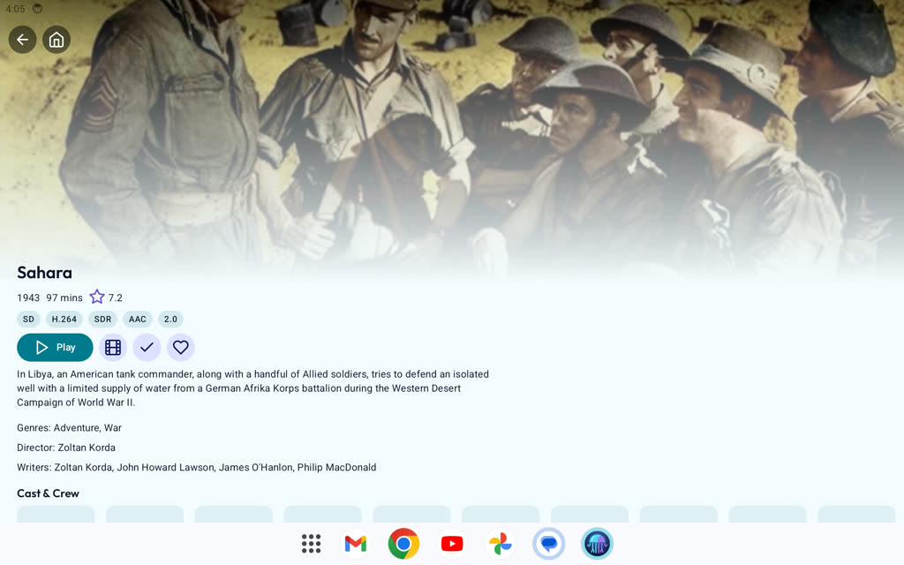 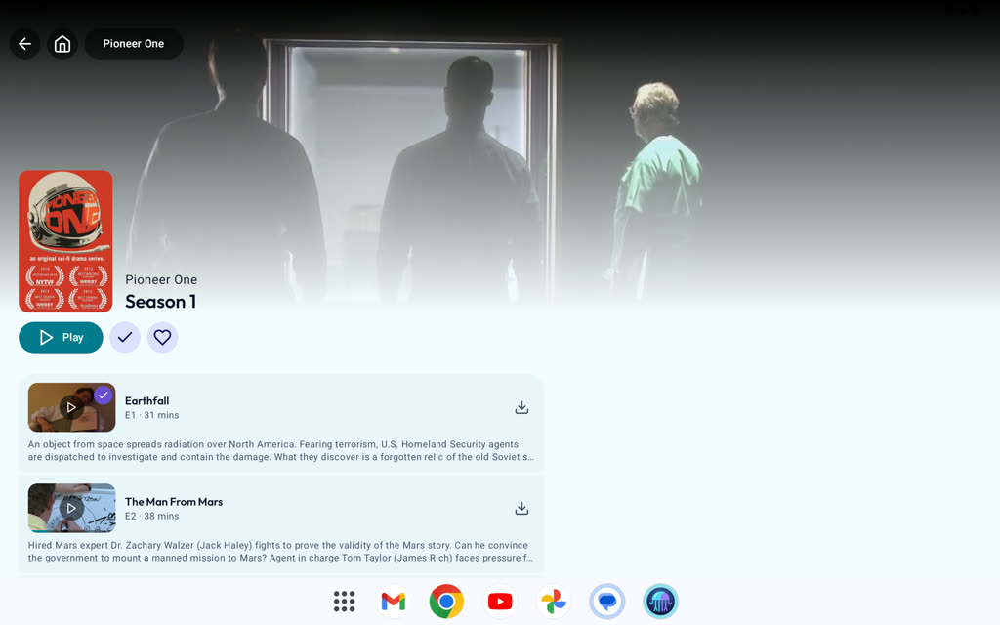

These are stop-gaps. They make the pages readable; the design in [4-design.md](4-design.md) replaces the single column with a real tablet layout.

**R6 (player orientation and edge gestures):** `PlayerActivity` no longer forces `sensorLandscape` from the manifest. It picks the orientation at runtime: forced landscape when the full-screen window's shorter side is under 600 dp (phones, folded foldables), unspecified otherwise, so a tablet plays in portrait (T7). On a player at least 840 × 480 dp, brightness and volume swipes only start within `clamp(width × 0.2, 96 dp, 240 dp)` of the left or right edge; a vertical swipe in the middle does nothing (T6, upstream #1144). Verified on a 1280×800 dp tablet AVD in both orientations and on the same AVD resized to a 411×914 dp phone.

**R4** (rows, grids, search bar, Downloads): cards, grid cells and the Downloads grid take their sizes from the `Layout` tokens (320 dp cards and 180 dp cells at expanded, unchanged on a phone), the Media search bar is capped at 720 dp, and Downloads puts its title at the top like Favorites on wide windows. Verified on the 1280 by 800 dp tablet AVD and a 411 dp phone window.

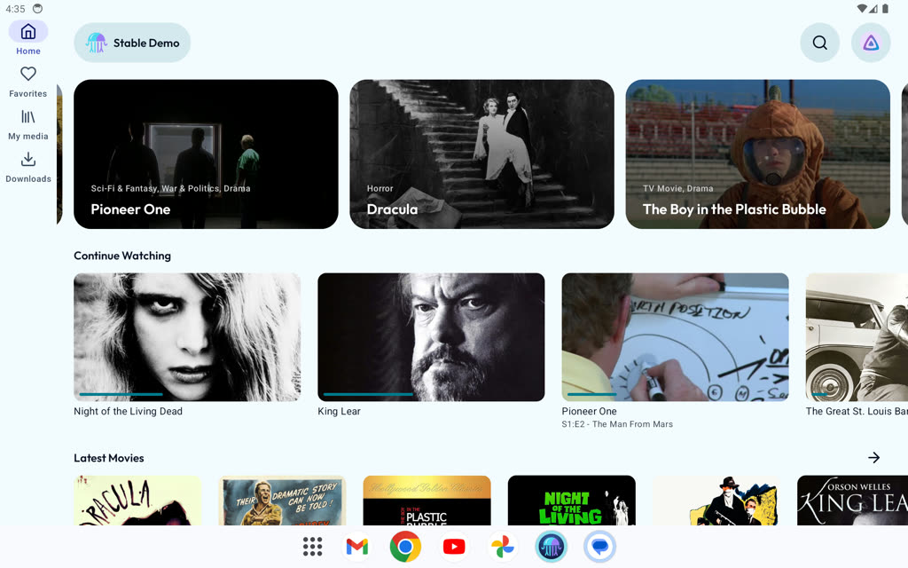 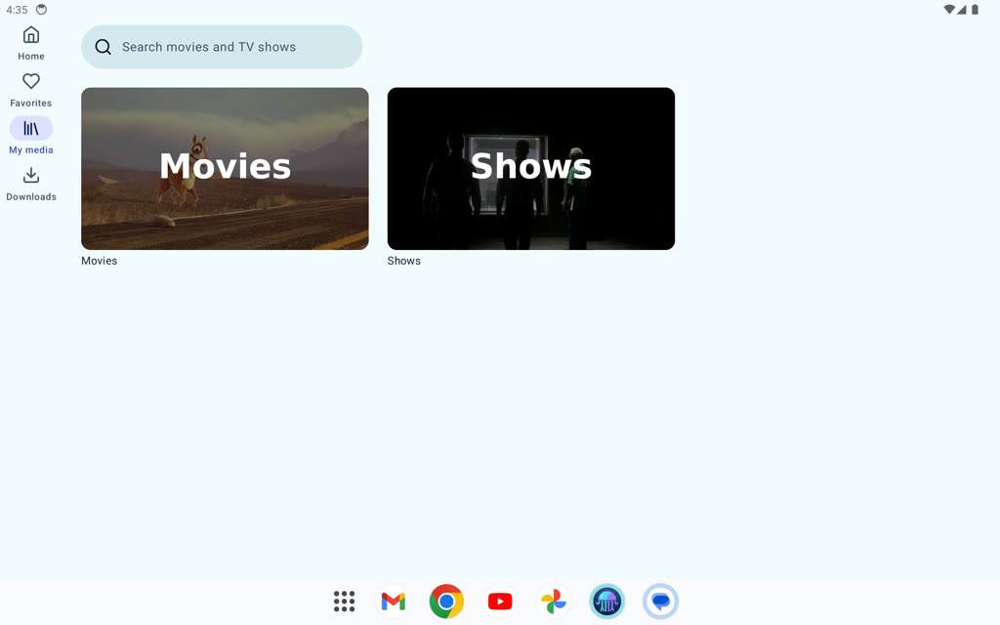

**R2 (T12).** `ItemHeader` and the new hero draw `scrimOverArt` from the top as well (10 % → 0 over 96 dp), and Movie, Show and Episode ask for light status-bar icons while the backdrop is behind the status bar, in both themes. Once the top bar has faded to the solid background the theme's default icons come back. This is the one change a phone shows (D7). Season still has T12; it is left to R5, which rewrites that page.

**R3 (T4, T5).** At medium and expanded width (but not at compact height, so a phone in landscape keeps the compact page) Movie, Show and Episode use the hero layout of [4-design.md](4-design.md) §6: a full-width backdrop cropped from the top centre, `max(320 dp, min(width × 9/16, window height × 0.55))` tall, with the poster (an episode's still) and the text column, capped at 720 dp, in its bottom part. Next Up, seasons and cast run below at full width. The R0 width caps on these three pages are gone. Landscape gets a 440 dp hero with a 200 dp poster; portrait gets 450 dp with 160 dp.

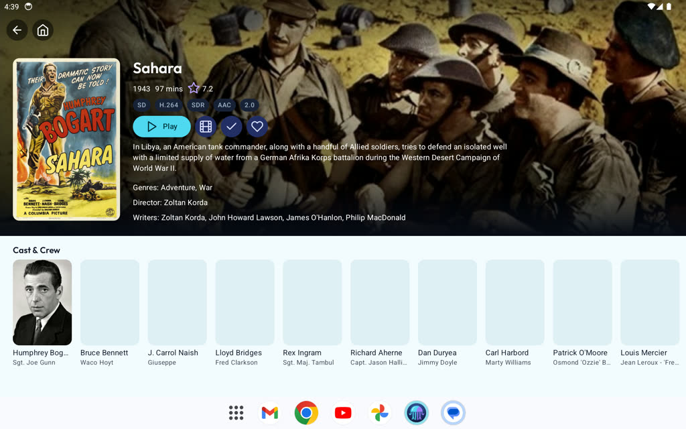 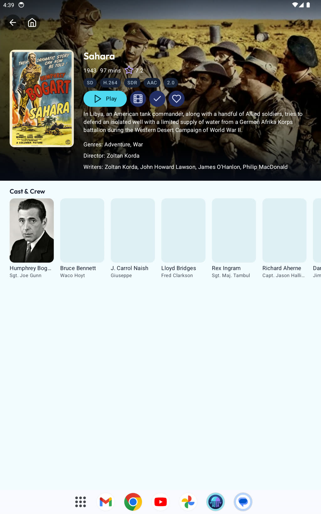

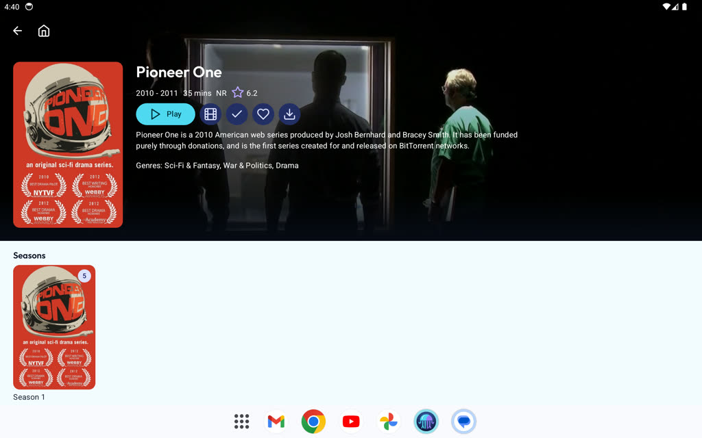 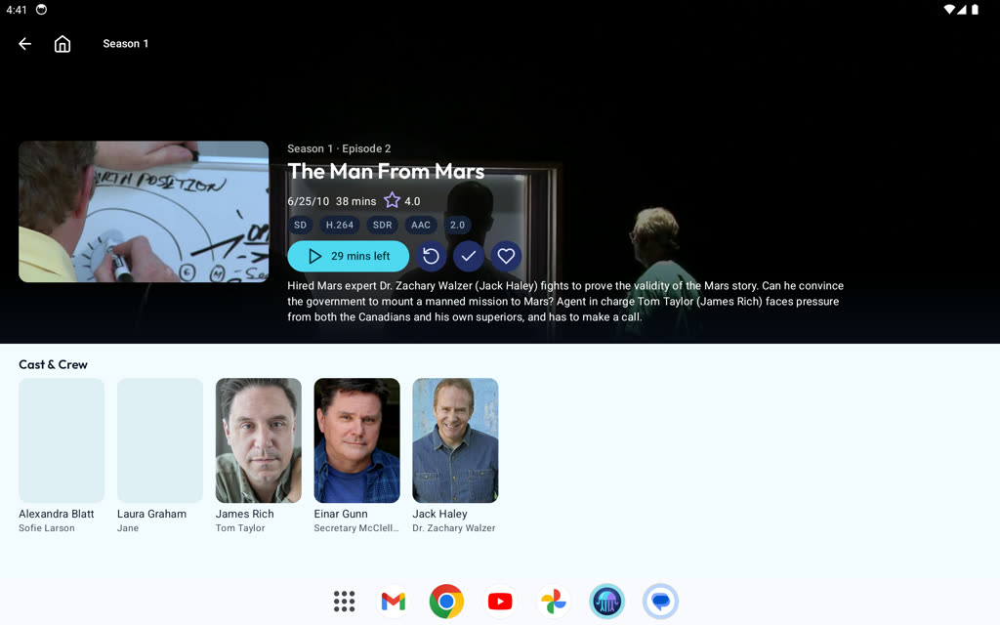

**R5 (season list-detail).** At expanded width (and not at compact height) the Season page is a list-detail, as in [4-design.md](4-design.md) §7: the season header and a compact episode list (still, title, `E2 · 38 mins`, watched tick, download state, no overview) on the left, 40 % of the window between 360 and 480 dp, and the selected episode's hero page on the right, without its own back and home buttons. Tapping an episode changes the right pane and does not navigate; the selected row is drawn in `secondaryContainer`. The season opens on its first unwatched episode. Play, watched, favourite and download in the right pane act on that episode, and the list follows (a watched tick appears as soon as it is marked). An episode opened on its own at expanded width (Home's Next Up and Continue Watching, search, Downloads) lands in the same list-detail with that episode selected. Rotating to portrait gives the single-column page; rotating back keeps the selection. Season also gets the light status-bar icons R2 gave the other item pages (T12), on every width. Verified on the 1280×800 dp tablet AVD in both orientations and on a 411 dp phone window, where Season and Episode are unchanged apart from those icons.

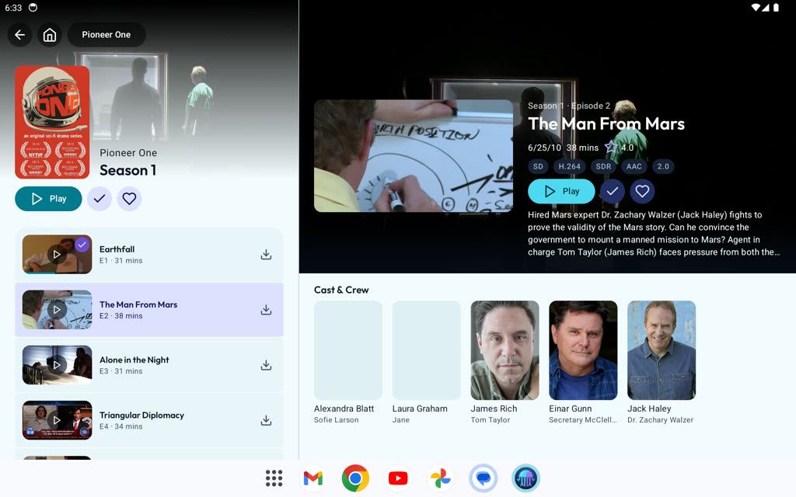 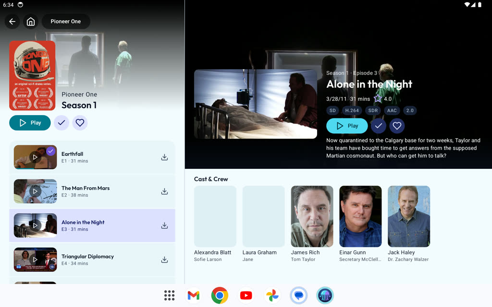

**R7 (T8, player controls at expanded).** The player's sizes are named dimens in `app/phone/src/main/res/values/dimens.xml` with the phone values, overridden in `values-w840dp-h480dp/` (no layout copies, no code): 48 dp between the five transport buttons (32), a 320×180 dp scrubber trickplay preview (272×153) and a 240×135 dp seek-bar preview (160×90), 80 dp gesture panels with 160 dp bars (64, 125), 16 sp time labels (14), 160×90 dp chapter thumbnails (120×68) and 64 dp double-tap ripples (50). The title was already `TitleLarge` (22 sp), so it stays. `h480dp` keeps a phone in landscape (about 915×411 dp) on the phone sizes, and a tablet in portrait is under 840 dp wide, so it does too. The bottom bar keeps its 16 dp padding and the default 26 dp time bar: at 1280 dp the bar already spans the width, its line sits 29 dp above the edge, and more padding would lift it away from the skip-segment button's 64 dp margin for no gain. Since `PlayerActivity` handles size changes itself, the sizes are picked when the player opens: rotating a tablet or resizing a split-screen window mid-playback keeps them until the player is opened again. Verified on the 1280×800 dp tablet AVD (button pitch 104 dp, trickplay box 340 dp with its padding, brightness bar 160 dp) and on the same AVD at 1080×2400, 420 dpi in landscape (button pitch 88 dp, as before).

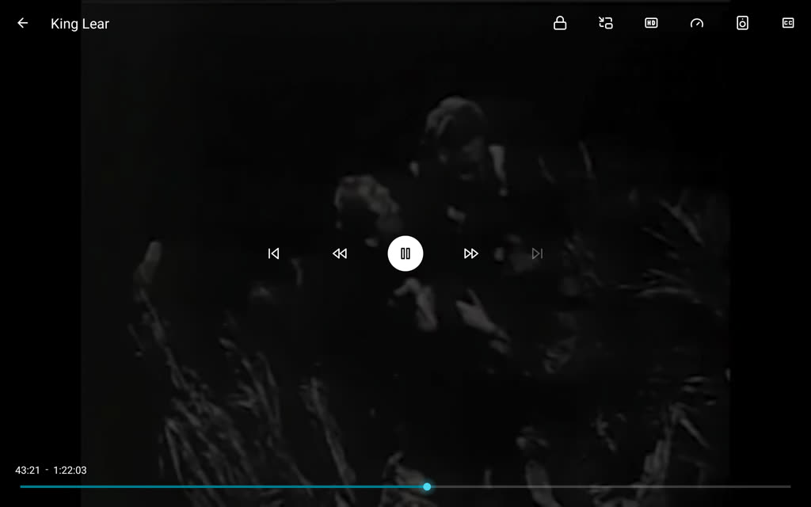

**R8 (keyboard and mouse, T15, #310).** The player takes a keyboard: Space plays and pauses, Left/Right seek 10 s back and 30 s forward (the TV remote's steps), Up/Down change the volume a step and show the swipe's volume panel, M mutes, L locks and unlocks the controls, Escape leaves the player as Back does, and the media keys (play/pause, next, previous, fast-forward, rewind) act without bringing up the controls. Any other key brings the controls up; once Tab has put focus on one of them, the arrows and Space go to that control instead. Moving a mouse shows the controls and the pointer hides with them; the wheel seeks a step per notch. Ctrl+F on My media opens the search bar with its field focused, also right after a touch, when nothing has focus. Cards already had the M3 focus and hover state layers through their `combinedClickable`; their long-press copies the title rather than opening a menu, so right-click has nothing to open and was left alone. Verified on the 1280×800 dp tablet AVD with a hardware keyboard (`adb shell input keyevent`, state read from `dumpsys media_session` and `dumpsys audio`) and on a 411 dp phone window, where touch, playback and Back are unchanged. Two limits: Android drops the first navigation key (arrows, Space, Tab) after a touch to leave touch mode, so the first press after tapping the screen does nothing; and a picture-in-picture window never gets key focus, so Escape cannot bring it back. Mouse hover and the wheel were not tested: the emulator turns the host mouse into touches and `adb shell input` has no hover or scroll.

**R9 (tabletop posture, #51; live control sizes).** On a foldable that is half-opened with the hinge horizontal, the player puts the video, its subtitles and the title bar above the hinge, and the transport row, the time bar, the volume and brightness panels and the unlock button below it ([4-design.md](4-design.md) §10). `PlayerActivity` collects `WindowInfoTracker.windowLayoutInfo` while started and sets margins on four full-size wrappers (`video_area` around the content frame, `lower_controls`, `gesture_panels`, and the locked overlay); flat, closed, a vertical hinge (book posture), a window the hinge doesn't cross and picture-in-picture all leave every margin at 0, which is the usual layout. Nothing is re-inflated and the player stays attached, so playback carries on. The same PR fixes R7's limit: `applyPlayerDimens()` re-applies the `player_*` sizes when the window crosses into or out of the `w840dp-h480dp` bucket, so rotating a tablet mid-playback now changes the controls too (the chapter list inflates its thumbnails each time it opens, so it needs nothing). Verified on the `pixel_fold` AVD (inner screen, 841×701 dp): flat, the layout is unchanged; half-opened in portrait (`adb emu posture 2`, `wm user-rotation lock 1`) the 4:3 picture fills the top half and the controls sit under the hinge, with the unlock button just below it when locked; back to flat restores the full layout; rotating to book posture while half-opened changes nothing, and rotating back into tabletop applies it again; picture-in-picture shows the whole picture and returning from it brings the split back. The position in `dumpsys media_session` kept advancing at 1× through every change (2391 s → 2394 s → 2426 s → 2435 s → 2442 s). On the 1280×800 dp tablet AVD the transport button pitch went 88 dp (portrait) → 104 dp (rotated to landscape mid-playback) → 88 dp (back to portrait), and at 1080×2400, 420 dpi it is 88 dp in the forced landscape, as before. Not reproduced: a real hinge with a non-zero width (the emulator's is 0 px, so nothing was checked against a gap), and a device whose tabletop posture is landscape.

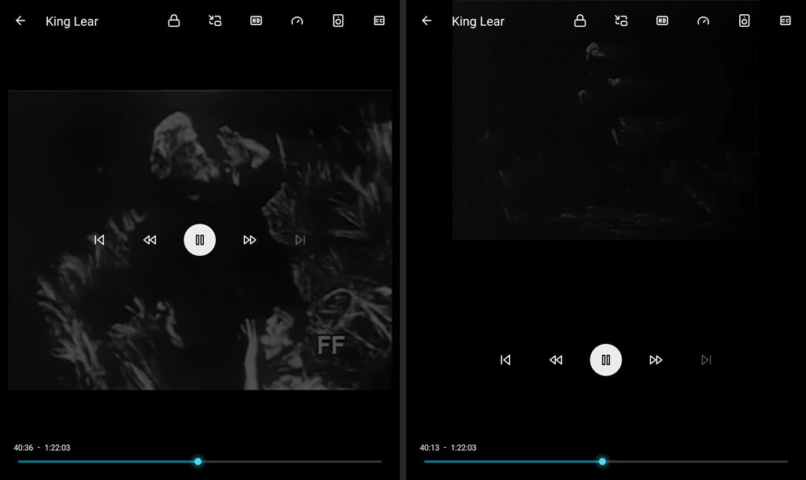

**R10 (episode side sheet, upstream #480).** At expanded width (the window at least 840 × 480 dp, R7's bucket, read from the window and never the device type) an episode in the player gets an episodes button at the end of the top-right group (`ic_list_video`, Lucide's outlined list-video, labelled with the existing "Episodes" string). It opens a side sheet over the right 30 % of the window (320 to 420 dp) with the playing season's episodes: a `ComposeView` over the player, with `CompactEpisodeRow` from the Season list-detail (now `internal`, without its download control here) driven by a `SeasonViewModel` created the first time the sheet opens, for the season the new `PlayerItem.seasonId` names. The playing episode is the selected row (`secondaryContainer`). Tapping another one calls `PlayerViewModel.playEpisode`: an episode in the queue (the season, once it has loaded) is jumped to as the TV queue row does (`PlaylistManager.jumpTo`), from its beginning, and anything else starts as a new item in the same player; the sheet closes either way. The sheet is `surfaceContainer` (dark scheme) at 92 %, with 24 dp corners on its left side, slides in from the right over 350 ms (`EmphasizedDecelerate`) and fades out over 200 ms. While it is open the video keeps playing and the controls stay up (their hide timeout is 0 until it closes). Back, Escape (which presses Back) and a tap anywhere outside it close it; locking the controls, picture-in-picture and leaving the expanded bucket close it at once and hide the button. Movies and smaller windows have no button. In tabletop posture the sheet joins the views below the hinge. Verified on the 1280×800 dp tablet AVD against the demo server (Pioneer One S1): in landscape the sheet opened with E1 highlighted and `dumpsys media_session` kept advancing (980 s → 988 s over 8 s) with the controls still up; tapping E3 closed it and `description=Alone in the Night` played from 0 s, with `S1:E3 - Alone in the Night` in the title; Back closed the sheet and left `PlayerActivity` on top, and `KEYCODE_ESCAPE` did the same; Dracula (a movie) had no button; rotating to portrait (800 dp wide) with the sheet open closed it and removed the button; at `wm size 1080x2400`, `wm density 420` the button group ends at the subtitle button, and after the reset the button was back. Not reproduced: tabletop posture (no foldable AVD in this run).

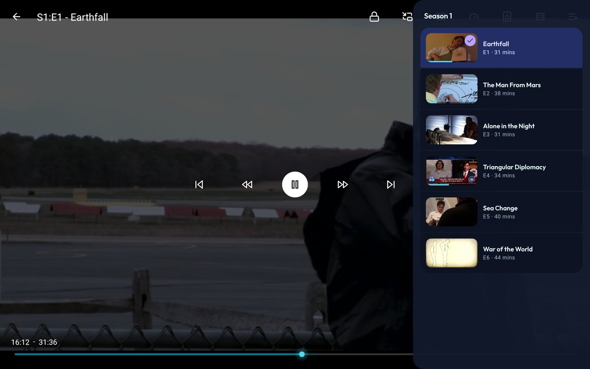
